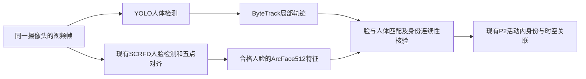

# GTR、ByteTrack与YOLO/ArcFace：时空算法优化核查

核查日期：2026-10-13（Asia/Singapore）。GTR 已由用户确认为 **Global Tracking Transformers**；后续补充 ByteTrack，以及“ByteTrack+ArcFace / 再添加YOLO检测”的选型。先核对本地当前源码，再查论文、官方仓库、固定提交和部署实现。本次只做调研与文档更新，没有安装模型、下载权重、运行推理或修改业务代码，因此没有本项目准确率、速度或现场效果结论。

**用户后续确认的交付范围：普通摄像头只连接已确认经过的相机点位；仅鹰眼单摄像头需要画面内连续运动轨迹，鹰眼分支后置。本轮先完成算法接口和本地查看，见[点位连接交付](point-connections.md)及[主交接第32节](../HANDOFF.md#point-connections-20261013)。普通分支保留现有SCRFD/ArcFace512与P2时间/身份/活动约束，新增可直接绘制的端点连接，不把YOLO、ByteTrack或GTR作为点位连线的必需依赖。下文连续视频模型比较保留为后续参考，尚未证明为现场最优。**

## 1. GTR 的对应论文和固定代码版本

- 论文：Xingyi Zhou、Tianwei Yin、Vladlen Koltun、Philipp Krähenbühl，**Global Tracking Transformers**，CVPR 2022，pp. 8771–8780，arXiv:2203.13250。已核对 [CVF 会议页](https://openaccess.thecvf.com/content/CVPR2022/html/Zhou_Global_Tracking_Transformers_CVPR_2022_paper.html)及 [arXiv v2 全文](https://arxiv.org/html/2203.13250v2)。
- 官方项目：[xingyizhou/GTR](https://github.com/xingyizhou/GTR)。2026-10-13 实时读取 GitHub API，`master` HEAD 为 **`7138b95b5c7951e763af2a3ced15cb29ac8fc9de`**，提交时间 `2022-08-02T18:47:06Z`，提交信息 `replicate demo (#22)`。以下代码链接固定到这个 SHA，避免分支漂移。[固定提交](https://github.com/xingyizhou/GTR/commit/7138b95b5c7951e763af2a3ced15cb29ac8fc9de) / [核查 API](https://api.github.com/repos/xingyizhou/GTR/commits/master)

论文事实：GTR 对一段视频内的检测目标做全局关联；检测特征作为 trajectory queries，关联输出按帧形成轨迹。论文 §4.3 明确用 Hungarian 将当前窗口轨迹接到已有轨迹，§5.5 说明最终模型没有采用空间/时间位置编码，§6 限制部分指出无法恢复超过窗口长度的缺失/遮挡。因此“全局”不能理解为跨所有摄像机、所有历史记录，摘要的“无需组合关联”也不能理解为推理完全不用匹配算法。[论文 §4–§6](https://arxiv.org/html/2203.13250v2)

## 2. 官方源码实际做了什么

以下为固定 SHA 的代码事实，未以论文描述替代代码核查。

1. **输入是同一视频的检测框与 RoI 特征。** `GTRROIHeads` 用 RoI pooler 和 FC head 得到 `reid_features`；这些是检测网络关联特征，并非直接使用 ArcFace 等人脸身份 embedding。`GTRRCNN.forward` 的注释明确全部输入来自同一 video。 [RoI 特征路径 L76–147](https://github.com/xingyizhou/GTR/blob/7138b95b5c7951e763af2a3ced15cb29ac8fc9de/gtr/modeling/roi_heads/gtr_roi_heads.py#L76-L147) / [视频输入 L50–61](https://github.com/xingyizhou/GTR/blob/7138b95b5c7951e763af2a3ced15cb29ac8fc9de/gtr/modeling/meta_arch/gtr_rcnn.py#L50-L61)
2. **多个历史帧的目标一起参与 attention。** 所有帧的特征拼接成 `1 × N × D`；encoder 看窗口内全部目标，decoder 以当前帧特征为 query，预测 query 与窗口目标的 `M × N` 关联分数。默认 `D=1024`、8 heads、1 层 encoder、1 层 decoder，关闭 decoder self-attention 和 LayerNorm。不是逐个检测框独立算一次余弦相似度。 [默认架构 L13–30](https://github.com/xingyizhou/GTR/blob/7138b95b5c7951e763af2a3ced15cb29ac8fc9de/gtr/config.py#L13-L30) / [query 选择 L59–95](https://github.com/xingyizhou/GTR/blob/7138b95b5c7951e763af2a3ced15cb29ac8fc9de/gtr/modeling/roi_heads/transformer.py#L59-L95) / [窗口调用 L115–126](https://github.com/xingyizhou/GTR/blob/7138b95b5c7951e763af2a3ced15cb29ac8fc9de/gtr/modeling/meta_arch/gtr_rcnn.py#L115-L126)
3. **按帧 softmax，显式保留“不匹配”。** 每帧检测候选后增加一个分数为 0 的背景项，再做 softmax，避免强制每个 query 在每帧都找一个目标。关联分数 head 对变换后的 query/key 做矩阵乘；MOT 配置将该 head 的附加 MLP 层数设为 0，但 attention 模块仍在。 [激活 L197–205](https://github.com/xingyizhou/GTR/blob/7138b95b5c7951e763af2a3ced15cb29ac8fc9de/gtr/modeling/roi_heads/gtr_roi_heads.py#L197-L205) / [分数 head L35–57](https://github.com/xingyizhou/GTR/blob/7138b95b5c7951e763af2a3ced15cb29ac8fc9de/gtr/modeling/roi_heads/association_head.py#L35-L57) / [MOT 配置 L13–19](https://github.com/xingyizhou/GTR/blob/7138b95b5c7951e763af2a3ced15cb29ac8fc9de/configs/GTR_MOT_FPN.yaml#L13-L19)
4. **轨迹分数再做唯一匹配。** 按已有 `track_ids` 汇聚历史关联分数，可配置时间衰减、最后位置 IoU、中心距离过滤；然后 `scipy.optimize.linear_sum_assignment(-traj_score)` 确保当前帧与已有轨迹唯一匹配，未过阈值者新建轨迹。代码是分数求和，阈值可按历史长度缩放，不能笼统称为总是直接平均分。 [轨迹拼接 L149–203](https://github.com/xingyizhou/GTR/blob/7138b95b5c7951e763af2a3ced15cb29ac8fc9de/gtr/modeling/meta_arch/gtr_rcnn.py#L149-L203)

工程推断：值得借鉴的是“候选窗口共同评估、允许不匹配、唯一分配”，不能仅换一个 embedding 或仅把余弦分数矩阵交给 Hungarian 就称为实现 GTR。真正复用学习关联 head，需要兼容特征、轨迹标签和训练过程。

## 3. 时间和空间信息的准确边界

| 核查点 | 固定版本事实 | 对当前方向的含义（工程推断） |
| --- | --- | --- |
| 空间位置编码 | MOT、TAO 均 `NO_POS_EMB: True`；最终 transformer 不加 box position embedding | GTR 不能直接替代站点地图、可达性或跨点位距离约束 |
| 时间位置编码 | 默认 `WITH_TEMP_EMB=False`，且被 `NO_POS_EMB` 的分支整体关闭 | 不可把该版本宣传成显式学习真实时间间隔的模型 |
| 时间结构 | 仍有按帧 softmax、历史窗口、当前帧 query；MOT 启用 `DECAY_TIME=0.9` | 没有 temporal embedding 不等于没有时间结构 |
| 空间后处理 | MOT 启用 `WITH_IOU=True`、`MAX_CENTER_DIST=1.0`；TAO 沿用关闭默认值 | IoU 是单图像坐标线索，不能直接比较两个独立摄像机的框 |
| 可选编码的定义 | box 坐标除以图像宽高；时间为窗口内帧下标，再除以窗口长度 | 已核查路径中没有真实时间戳、camera_id、地图坐标或设备通行拓扑输入 |

依据：[MOT 配置 L13–49](https://github.com/xingyizhou/GTR/blob/7138b95b5c7951e763af2a3ced15cb29ac8fc9de/configs/GTR_MOT_FPN.yaml#L13-L49)、[TAO 配置 L25–50](https://github.com/xingyizhou/GTR/blob/7138b95b5c7951e763af2a3ced15cb29ac8fc9de/configs/GTR_TAO_DR2101.yaml#L25-L50)、[默认开关 L29–30、L72–80](https://github.com/xingyizhou/GTR/blob/7138b95b5c7951e763af2a3ced15cb29ac8fc9de/gtr/config.py#L29-L80)、[编码分支 L165–194](https://github.com/xingyizhou/GTR/blob/7138b95b5c7951e763af2a3ced15cb29ac8fc9de/gtr/modeling/roi_heads/gtr_roi_heads.py#L165-L194)、[坐标/时间定义 L302–356](https://github.com/xingyizhou/GTR/blob/7138b95b5c7951e763af2a3ced15cb29ac8fc9de/gtr/modeling/roi_heads/gtr_roi_heads.py#L302-L356)。

## 4. 已发表结果及不能外推的部分

| 官方报告场景 | 官方结果 | 证据 |
| --- | --- | --- |
| MOT17 test | MOTA 75.3；IDF1 71.5；HOTA 59.1；DetA 61.6；AssA 57.0；FPS 19.6 | [官方 README](https://github.com/xingyizhou/GTR/blob/7138b95b5c7951e763af2a3ced15cb29ac8fc9de/README.md) |
| MOT17 half validation，GTR | MOTA 71.3；IDF1 75.9；HOTA 63.0；AssA 66.2 | [MODEL_ZOO L26–32](https://github.com/xingyizhou/GTR/blob/7138b95b5c7951e763af2a3ced15cb29ac8fc9de/docs/MODEL_ZOO.md#L26-L32) |
| 同验证集 local/FairMOT baseline | MOTA 71.1；IDF1 74.2；HOTA 62.1；AssA 64.4；同一组模型权重 | [MODEL_ZOO L31–46](https://github.com/xingyizhou/GTR/blob/7138b95b5c7951e763af2a3ced15cb29ac8fc9de/docs/MODEL_ZOO.md#L31-L46) |
| TAO | validation tracking mAP 22.5；test 20.1；官方 README FPS 11.2；仅约 1 FPS 的关键帧评测 | [MODEL_ZOO L48–59](https://github.com/xingyizhou/GTR/blob/7138b95b5c7951e763af2a3ced15cb29ac8fc9de/docs/MODEL_ZOO.md#L48-L59) / [README](https://github.com/xingyizhou/GTR/blob/7138b95b5c7951e763af2a3ced15cb29ac8fc9de/README.md) |

以上是作者在公开基准上的报告。MOTA/IDF1/HOTA/AssA、TAO 的 tracking mAP 都不等于本项目的跨摄像机人脸误合并率、活动身份正确率、路径合法率，也不是现在已经测出的上线吞吐。`75.3 MOTA` 不能写成“现场准确率 75.3%”。这些原始结果也不能作为 2026 年仍领先的证据。

## 5. 窗口、训练、运行和成熟度

- **窗口要区分模型。** 官方基础默认 `TRAIN_LEN=8`、`TEST_LEN=16`；MOT 配置测试窗为 32，TAO 为 16。两者训练窗均为 8；训练 mapper 可按缩放动态增加实际训练帧数，因此 8 是配置基值。不能把 README 的 32 帧当成所有配置的固定值。 [config L63–68](https://github.com/xingyizhou/GTR/blob/7138b95b5c7951e763af2a3ced15cb29ac8fc9de/gtr/config.py#L63-L68) / [MOT L40–42](https://github.com/xingyizhou/GTR/blob/7138b95b5c7951e763af2a3ced15cb29ac8fc9de/configs/GTR_MOT_FPN.yaml#L40-L42) / [TAO L48–50](https://github.com/xingyizhou/GTR/blob/7138b95b5c7951e763af2a3ced15cb29ac8fc9de/configs/GTR_TAO_DR2101.yaml#L48-L50) / [mapper L138–162](https://github.com/xingyizhou/GTR/blob/7138b95b5c7951e763af2a3ced15cb29ac8fc9de/gtr/data/gtr_dataset_mapper.py#L138-L162)
- **官方复现资源较重。** Model Zoo 说多数训练用 4 张 32GB V100；MOT 32 帧测试需要超过 12GB 显存。MOT 从 CrowdHuman 检测器微调，并混用 MOT17/CrowdHuman；TAO 版本只用 LVIS+COCO，mapper 对静态图片合成运动视频。上述资源是作者文档，未在用户硬件上验证。 [MODEL_ZOO L5–7、L43–59](https://github.com/xingyizhou/GTR/blob/7138b95b5c7951e763af2a3ced15cb29ac8fc9de/docs/MODEL_ZOO.md#L5-L59) / [MOT 数据集 L50–57](https://github.com/xingyizhou/GTR/blob/7138b95b5c7951e763af2a3ced15cb29ac8fc9de/configs/GTR_MOT_FPN.yaml#L50-L57) / [合成运动 L166–187](https://github.com/xingyizhou/GTR/blob/7138b95b5c7951e763af2a3ced15cb29ac8fc9de/gtr/data/gtr_dataset_mapper.py#L166-L187)
- **依赖不是当前生产环境验证。** INSTALL 要求 Linux/macOS、Python≥3.6、PyTorch≥1.8、Detectron2，含 CenterNet2 子模块。`requirements.txt` 未锁 opencv-python/timm/lvis/lap/scipy/TAO Git 依赖；`cog.yaml` demo 是 Python 3.8、Torch 1.8.1、CUDA 10.1。不能直接推定 Windows、离线安装、现有 CUDA 或新版 PyTorch 可用。 [INSTALL](https://github.com/xingyizhou/GTR/blob/7138b95b5c7951e763af2a3ced15cb29ac8fc9de/docs/INSTALL.md) / [requirements](https://github.com/xingyizhou/GTR/blob/7138b95b5c7951e763af2a3ced15cb29ac8fc9de/requirements.txt) / [cog.yaml](https://github.com/xingyizhou/GTR/blob/7138b95b5c7951e763af2a3ced15cb29ac8fc9de/cog.yaml) / [.gitmodules](https://github.com/xingyizhou/GTR/blob/7138b95b5c7951e763af2a3ced15cb29ac8fc9de/.gitmodules)
- **关联因果在线，官方入口仍要求整视频。** `sliding_inference` 按帧更新，只看当前和历史窗口；但 `forward` 明说测试需加载整段视频，on-the-fly 是 TODO。末尾还做整视频短轨过滤和可选延迟分类。因此需要另外改造流式输入、内存和输出契约。 [入口 L50–55](https://github.com/xingyizhou/GTR/blob/7138b95b5c7951e763af2a3ced15cb29ac8fc9de/gtr/modeling/meta_arch/gtr_rcnn.py#L50-L55) / [滑窗及末尾处理 L76–112](https://github.com/xingyizhou/GTR/blob/7138b95b5c7951e763af2a3ced15cb29ac8fc9de/gtr/modeling/meta_arch/gtr_rcnn.py#L76-L112) / [短轨/分类 L206–248](https://github.com/xingyizhou/GTR/blob/7138b95b5c7951e763af2a3ced15cb29ac8fc9de/gtr/modeling/meta_arch/gtr_rcnn.py#L206-L248)
- **许可证可复用，但逐项保留声明。** 官方 README 和 LICENSE 给出主体 Apache-2.0；TrackEval/FairMOT 部分 MIT，NOTICE 有对应声明。模型权重、训练数据、demo 视频不能仅据主体代码许可证推定许可相同。 [LICENSE](https://github.com/xingyizhou/GTR/blob/7138b95b5c7951e763af2a3ced15cb29ac8fc9de/LICENSE) / [NOTICE](https://github.com/xingyizhou/GTR/blob/7138b95b5c7951e763af2a3ced15cb29ac8fc9de/NOTICE) / [README License](https://github.com/xingyizhou/GTR/blob/7138b95b5c7951e763af2a3ced15cb29ac8fc9de/README.md#license)

成熟度判断（工程判断）：这是有正式论文、官方代码、模型和基准的研究方案，适合作为复用候选与对照；当前主分支代码仍停在 2022 年，且存在整视频输入限制与旧依赖，不能直接认定它是已适配本项目的生产方案。

## 6. 复用边界与交接注意

可优先复用/参考的模块是 `GTRROIHeads._forward_transformer`、`Transformer`、`ATTWeightHead` 和窗内轨迹分数汇聚；适合在单路连续视频已有框与视觉特征的前提下，评估遮挡、相似外观、人群交叉时的关联质量。跨摄像机稀疏人脸事件若只提供 embedding、点位与时间戳，就与原始 GTR 输入/监督任务不同；需要保留本项目活动隔离、真实时间差、拓扑可达性、时钟质量和不确定状态。这是工程推断，不是论文已经证明的适用性。

本次方法：先查 CVF/arXiv 确认论文，再用 GitHub REST 固定 SHA，经 raw 官方源码逐项核对 architecture、query、encoding、softmax、Hungarian、窗口、训练入口、依赖和许可证。未使用二手博客或社区评论作为技术证据。

本次发现的坑和处理：

1. CVF PDF 直接打开返回 403，改读官方 arXiv v2 HTML/PDF，保留 CVF 出版信息核查。
2. 论文“全局关联”和“无组合关联”容易被扩大解释；用 `GTRRCNN` 的实际滑窗和 Hungarian 明确窗内/窗间边界。
3. 摘要/README 的 32 帧与 TAO 官方 16 帧配置不一致；按实际模型配置记录，而不是统一套用。
4. 默认 config 支持位置编码不代表模型用了编码；追到 MOT/TAO YAML 和 `_forward_transformer` 分支确认实际关闭。
5. 论文与代码不能一概等同：论文训练框匹配公式采用 IoU 0.5，而固定代码 `_get_asso_gt` 的选取条件是 `val > 0.0`；这不是本次认定的 bug，但重新训练复现前需要明确采用哪个契约。 [代码 L208–252](https://github.com/xingyizhou/GTR/blob/7138b95b5c7951e763af2a3ced15cb29ac8fc9de/gtr/modeling/roi_heads/gtr_roi_heads.py#L208-L252) / [论文 §4.2](https://arxiv.org/html/2203.13250v2)
6. 维护状态和许可证不同来源需分别核对：GitHub API 的自动 license 字段为空，但原始 LICENSE 明确 Apache-2.0；按文件内容及 NOTICE 判断，不能把自动识别缺失当成无许可证。

下一步交接：以固定 SHA 做隔离基准，再以相同检测/特征输入和相同数据划分比较关联质量；若只借用窗内共同评估思想，应标注为本项目改造，不冠名为已经复现原 GTR。新增实验应同时记录误合并、漏关联、遮挡恢复、内存、吞吐和延迟，并独立给出跨摄像机事件回放结果。

## 7. ByteTrack论文、源码和部署复用

论文为 Yifu Zhang 等的 **ByteTrack: Multi-Object Tracking by Associating Every Detection Box**，ECCV 2022；[会议页](https://www.ecva.net/papers/eccv_2022/papers_ECCV/html/315_ECCV_2022_paper.php)、[论文](https://arxiv.org/abs/2110.06864)、[官方仓库](https://github.com/FoundationVision/ByteTrack)。2026-10-13实时GitHub API核查：main HEAD为 `d1bf0191adff59bc8fcfeaa0b33d3d1642552a99`，提交时间2022-12-11，archived=false；这是有论文、公开模型及部署实现的经典候选，不能据此称仍持续维护或对本现场最优。[固定提交](https://github.com/FoundationVision/ByteTrack/commit/d1bf0191adff59bc8fcfeaa0b33d3d1642552a99)、[API](https://api.github.com/repos/FoundationVision/ByteTrack/commits/main)

固定源码按检测分数划分高分/低分框，以Kalman预测框和IoU完成两阶段关联：先高分框，再用低分框续接尚未匹配的活跃轨迹，剩余高分框可新建轨迹。原版关联路径没有ArcFace或人体ReID，也没有摄像头地图。低分框的用途是跟踪续接，并不证明其中的人脸可用于身份确认。[Python关联L159–276](https://github.com/FoundationVision/ByteTrack/blob/d1bf0191adff59bc8fcfeaa0b33d3d1642552a99/yolox/tracker/byte_tracker.py#L159-L276)

| 固定实现细节 | 接入需要处理的事项（工程判断） |
| --- | --- |
| Python每次update把frame_id加1；Kalman模型dt固定为1；frame_rate只缩放lost buffer | 现有1/2/6fps动态采样、队列丢帧、重连都需要处理实际时间间隔。仅修改frame_rate参数不能解决不规则dt；改用时间驱动运动/过期策略并验证，或保持有界稳定跟踪频率、长间隔主动断轨 |
| Python低分框筛选为score>0.1且低于track_thresh，新轨阈值为track_thresh+0.1 | 检测器若先删除这些低分框，二阶段价值消失。跟踪低分候选与人脸身份质量门槛应分开；不得降低ArcFace身份准入来“复用低分框” |
| TensorRT/ncnn C++版本构造器固定0.5/0.6/0.8阈值，低分分支收其余传入框 | 不能认定Python/C++行为完全一致；应核对外部检测后处理、阈值边界与同输入输出，再移植所需tracker模块 |
| 原版依赖图像坐标下的IoU/运动 | 同镜遮挡短时续接可评估；低帧率、大位移、人群交叉及长时间遮挡仍可能断轨或ID switch；跨镜不能比较框IoU |

依据：[Python初始化/更新](https://github.com/FoundationVision/ByteTrack/blob/d1bf0191adff59bc8fcfeaa0b33d3d1642552a99/yolox/tracker/byte_tracker.py#L145-L185)、[Kalman dt L40–48](https://github.com/FoundationVision/ByteTrack/blob/d1bf0191adff59bc8fcfeaa0b33d3d1642552a99/yolox/tracker/kalman_filter.py#L40-L48)、[C++构造与分框](https://github.com/FoundationVision/ByteTrack/blob/d1bf0191adff59bc8fcfeaa0b33d3d1642552a99/deploy/TensorRT/cpp/src/BYTETracker.cpp#L4-L65)。

官方有[TensorRT C++](https://github.com/FoundationVision/ByteTrack/tree/d1bf0191adff59bc8fcfeaa0b33d3d1642552a99/deploy/TensorRT/cpp)和[ncnn C++](https://github.com/FoundationVision/ByteTrack/tree/d1bf0191adff59bc8fcfeaa0b33d3d1642552a99/deploy/ncnn/cpp)实现，代码[MIT](https://github.com/FoundationVision/ByteTrack/blob/d1bf0191adff59bc8fcfeaa0b33d3d1642552a99/LICENSE)。可提取跟踪模块接现有检测器，无需因复用tracker整套替换P1；选定的检测模型权重与训练数据另核查。作者MOT17报告MOTA80.3、IDF177.3、HOTA63.1；单V100约30fps，不能直接与不同检测器的GTR结果比较来宣布关联器更优，也不能外推600路3090容量。[论文](https://arxiv.org/abs/2110.06864)

## 8. 加YOLO后的职责与完整链路

用户提出的YOLO此处按**人体检测**理解；具体版本、输入分辨率和权重尚未选定。ByteTrack官方支持接外部检测器的框/分数，原论文系统使用YOLOX；[YOLOX官方](https://github.com/Megvii-BaseDetection/YOLOX)提供ONNX/TensorRT/ncnn等部署，根代码为Apache-2.0。本次实时核查其main HEAD为 `6ddff4824372906469a7fae2dc3206c7aa4bbaee`（2025-06-08），可作为经典检测基线，未安装、未评估该权重，也不把它与工作区X-ray用途的模型混用。[固定版本](https://github.com/Megvii-BaseDetection/YOLOX/tree/6ddff4824372906469a7fae2dc3206c7aa4bbaee)、[部署](https://github.com/Megvii-BaseDetection/YOLOX/tree/6ddff4824372906469a7fae2dc3206c7aa4bbaee/demo)、[LICENSE](https://github.com/Megvii-BaseDetection/YOLOX/blob/6ddff4824372906469a7fae2dc3206c7aa4bbaee/LICENSE)。

| 组件 | 负责的结果 | 本项目适配判断 |
| --- | --- | --- |
| YOLO人体检测 | 当帧person bbox/score | 有机会延续背身/无脸时的身体轨迹；它不输出实名身份。只要脸经过点位时，可不增加此模型 |
| ByteTrack | 同摄像头local_track_id和框序列 | 适合先做局部连续性、选帧与有限去重；track ID不能直接等同业务person_id/跨镜target_id |
| 已有SCRFD | 人脸框、分数和五点关键点 | 保留当前质量、对齐和512D特征合同；常规YOLO person模型不能替代五点人脸检测器 |
| 已有ArcFace | 对齐人脸的身份embedding | 必须输入合格对齐人脸；不能把整个人体框送入ArcFace来完成背身ReID |
| 现有P2 | 活动内登记/匿名身份、时间准入、跨镜可行性、点位经过链 | 保留真实采集时间、topology UNKNOWN、版本修订、持久化与168小时政策 |
| GTR | 单视频窗口的学习关联 | 若ByteTrack在同输入视频中仍有大量交叉/遮挡关联错误，再作隔离对照；不默认与ByteTrack串联双重维护同一局部ID |

脸—人体绑定是需要实现和验证的模块：在同一实际帧、同一原图坐标中，以脸框包含关系、身体上部位置、轨迹连续性及一对一分配生成候选；多人框重叠时保持未绑定，不仅凭“最近身体框”确认身份。人体/人脸裁剪和缩放须还原原图坐标，人脸质量继续按原图像素计算。身份只从合格人脸证据建立；低分框可续轨，但不能补造人脸特征或把旧脸特征伪装成新的当前抓拍。

一旦局部轨迹发生交叉、断线、长时间缺帧或新脸与原身份不一致，应解除/暂缓绑定并重新核验，而非把上一次实名标签一直传递。同镜人体连续输出可以作为单独候选显示；无合格脸的每一帧不能直接生成当前P2需要的确认人脸观测。若将人体事件正式接P2，需要另立非人脸证据合同。

仅有离散人脸抓拍时，ByteTrack和GTR都缺连续框序列，优先维持已有SCRFD/ArcFace+P2；不能凭添加YOLO补出缺失帧。不同相机各自的局部track作用域至少包含activity/source/camera/session；允许重叠摄像头同时观测同一人。一个窗口中同一人的多次观测不能套用全窗口“一人只能匹配一条”规则。

## 9. 本地当前源码复核与真正的优化位置

以下为本次读源码/合同的结论，没有重新运行旧测试；当前状态不沿用历史记忆中“活动隔离/七天保留未实现”的旧结论。

| 当前位置 | 已有行为 | 可评估的增量 |
| --- | --- | --- |
| [association.cpp](../cpp/src/association.cpp) L245–276、366–465 | 逐事件512D精确检索；按人最佳模板；可行候选的top1/top2与margin；完整历史的时间/图可行性；决定后立即保存/按门槛补模板。Top8只是显示范围 | 对待定事件进行有界窗口联合候选评估，减少先来事件影响后续身份的风险；先只在离线旁路比较，尚未实现自动窗口提交 |
| [gallery.cpp](../cpp/src/gallery.cpp) L66–88、175–218 | 特征空间分桶、SIMD双精度累积、较大库OpenMP、每人多模板最大分数 | 在精确竞争者不被遗漏及阈值附近数值稳定的前提下，评估批量检索；不能把已有优化说成缺失，也不能用固定TopK/ANN省略潜在竞争者 |
| [time_constraints.cpp](../cpp/src/time_constraints.cpp) L8–98 | 全链时间外包络、有向图/开放窗口；时间重叠组超过12条或预算不足返回UNKNOWN | 缓存有版本和有效期的相同可行性问题，并测大量重叠事件的UNKNOWN比例；预算不足不能转为不可达 |
| [trajectory_bridge.py](../../face-recognition-engine/src/face_engine/trajectory_bridge.py) L251–289 | SCRFD检测后质量检查、对齐、ArcFace；允许外部按face_index提供local_track_id+track_session_id | ByteTrack在当前入口尚未接入；可以给跟踪和合格选帧加适配。face_index来自框排序，外部绑定必须对应本次实际检测，不能用上一帧索引 |
| [monitoring_service.py](../../face-recognition-engine/src/face_engine/monitoring_service.py) L121–125、396–407 | 按6/2/1fps目标采样、取最新帧；实际间隔受调度影响 | 分开跟踪更新频率和昂贵身份提取频率；不把随机抽帧直接当等间隔30fps轨迹 |
| [association合同](association.md)、[多活动服务](activity-service.md) | 活动隔离、准入、168小时清理；同键稳定重试；确认归属修订显式进行 | 新tracker缓存/体框/候选同样纳入隔离和期限；不能用改event ID或raw/rebuild绕开入流合同 |

当前P1已有模糊、姿态、裁边等质量门槛，不能说完全没有质量控制。P2自动模板保留按detection_score×face_size_px排序，与完整质量模型不同。可评估局部轨迹的多张独立优质脸作稳健身份证据，减少单张异常模板影响；混合身份轨迹不可直接平均embedding，派生聚合策略需要版本和新阈值验证。

跨镜软时间先验可参考AAAI 2019 [Spatial-Temporal Person Re-Identification](https://ojs.aaai.org/index.php/AAAI/article/view/4921)：论文将视觉相似度与相机/时间分布融合。本项目仅可在有独立同人样本后评估该思想，不能把未经核实的通路或历史算法自己的归组当训练真值；真实时间不确定区间须纳入处理。稀有路径/长停留不应只因概率低被硬排除。此项属于后续候选，并未移植或校准。

## 10. 离线比较、接手要求及未完成项

建议先比较三组：A=现有SCRFD/ArcFace+P2；B=A加ByteTrack脸框跟踪/选帧；C=YOLO人体+ByteTrack，保留相同SCRFD/ArcFace，增加脸—人体绑定。GTR另列D，若更换其原生检测器，必须标注为整套系统对照；要比较关联器本身则冻结相同框和兼容特征输入，并承认该实验是适配版本。

连续视频用独立frame/bbox/track标注评估IDF1/HOTA、ID switches、遮挡恢复；P2用独立same/different-person及登记标签评估错误关联、未知误接受、匿名错并/错分、拒绝与确认覆盖。所有分支均统计P1漏检、质量拒绝、丢帧、脸—人体错绑，不能仅看跟踪器指标。按活动和场景分别统计p95/p99结果延迟、真实检测/提特征调用量、GPU/显存/CPU和实际吞吐；“减少ArcFace调用”是待测收益，新增YOLO/SCRFD/解码成本也计入。

本地已有[事件评估器](../tools/evaluate_identity_events.py)只支持P2_FEATURE_EVENTS，不能计算视频HOTA或端到端图片召回。它冻结除worker SHA外的全部manifest和请求时间线；B/C若改变送入P2的选帧集合、局部track字段、YOLO/聚合策略，不能直接作为“同输入非退步比较”传入。应新增明确的端到端共同原始视频分母/遗漏事件计算及候选配置审计，保留原评估器严格合同。A/B/C训练/调参/测试集合分开，不能用测试身份标签调阈值。

当前monitoring同键ACCEPTED结果不能通过普通重试自动重算（[monitoring.cpp](../cpp/src/monitoring.cpp) L122–135）；核心reconsider能力不等于外部已有窗口重判入口。若实现窗口联合确认，需要明确pending/final状态、处理延迟、幂等、版本CAS、改归属的受影响目标、事务/投递以及过期处理。初期旁路仅输出候选评估结果，不向正式库提交“模型建议人工纠错”来充当自动识别成绩。

真正实施前需补齐：可授权用于开发的连续视频（含交叉/背身/遮挡）、独立人/脸/身体关联标签、实际相机采样和钟源、目标服务器资源/延迟要求、所选YOLO/ArcFace权重来源与用途许可。现有交接第30节记录尚无独立现场标签；本次未重新查服务器或数据目录，因此不把该历史数量当当前数据盘点。600路及2–3秒目标来自现有[P1运行合同](../../face-recognition-engine/docs/monitoring-runtime.md)，本次未做容量测试。

方法/坑点/经验：先查当前实现，避免重复建设已完成的活动隔离与保留；固定官方commit逐项对照，区分Python/C++阈值和运动时间定义；跟踪框低阈值与身份门槛分离；原图人脸像素不能被人体ROI缩放伪增；track切换不得传播身份；公开MOT指标和本项目跨镜误认分别验收。准确率、吞吐提升都需独立同输入实验，论文数字只作作者基准。

交接状态：论文/源码适配调研和文档更新完成；YOLO/ByteTrack/GTR均未接入本地正式算法、没有新增推理或数据库迁移。真实数据评估、后端联调、生产部署和目标容量验收均未执行。现有模型、C++/Go、活动/时钟/保留启动沿用[主交接](../HANDOFF.md)第27–30节；下一次实施先确认视频分支与所需标签，复用单一交接入口记录结果。
